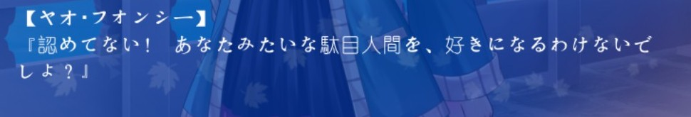
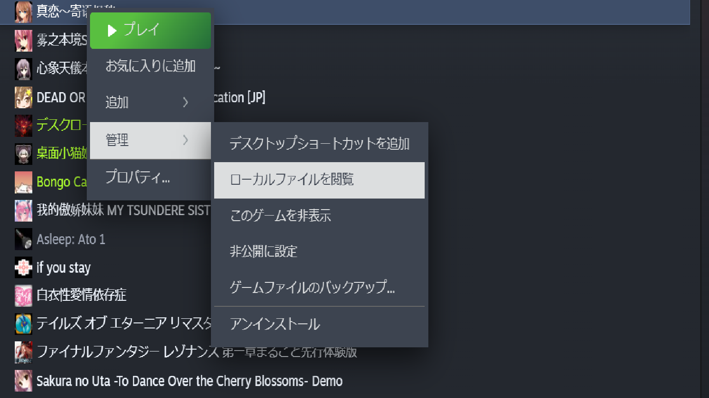
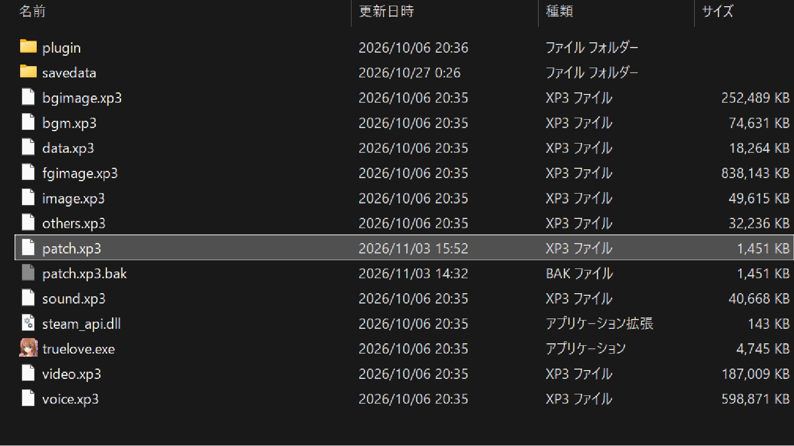

# 真恋～寄语枫秋～ 日本語化MOD

Steam 版 **『真恋～寄语枫秋～』**（True love \~Confide to the maple\~ / SP-time）の
**本文を日本語で読めるようにする非公式MOD**です。

`patch.xp3` を1つ置くだけで適用でき、**削除すれば完全に元に戻ります**。
ゲーム本体のファイルは一切書き換えません。

適用すると、本文はこのように日本語で表示されます。



| 項目 | 内容 |
|---|---|
| 対応 | Steam 版『真恋～寄语枫秋～』 |
| 導入 | `patch.xp3` をゲームフォルダにコピーするだけ |
| ゲーム内言語 | 簡体字 / 繁体字 / English の**どれでも日本語**になります |
| 元に戻す | `patch.xp3` を削除するだけ |
| ファイル | `patch.xp3` 1個（約 1.4 MB） |
| 版 | v1.2（2026-11-04） |

---

## ダウンロード

**方法1（かんたん）** — このページ右上の **`Code` → `Download ZIP`**（コード → ZIPでダウンロード）

**方法2（ファイル1個だけ欲しい場合）** — 下の **`版1.2`** フォルダを開き、中の
[`patch.xp3`](版1.2/patch.xp3) を開いて、右上の **ダウンロードボタン**（Download raw file）を押す

> ZIP は GitHub が自動で作るものです。中身はこのページに並んでいるファイルと同じなので、
> どちらで落としても `patch.xp3` が入っています。
> **使うのは `版1.2` フォルダの `patch.xp3` だけです。**
> 過去の版が必要な場合は、右側の **Releases** から該当バージョンを開いて `Source code (zip)` をダウンロードしてください。

---

## 使い方（3ステップ）

### 1. ゲームのフォルダを開く

Steam ライブラリで『真恋～寄语枫秋～』を右クリック → **管理** → **ローカルファイルを閲覧**



### 2. `patch.xp3` を置く

開いたフォルダ（`truelove.exe` がある場所）に、ダウンロードした **`patch.xp3`** をコピーします。



> `data.xp3` などの元のファイルは**触らないでください**。追加するのは `patch.xp3` の1個だけです。
> すでに `patch.xp3` がある場合は、このMOD以外のパッチと競合する可能性があります。

### 3. ゲームを起動する

**ゲーム内の言語設定はどれでも構いません。**
簡体字中国語・繁体字中国語・English のいずれを選んでも、本文は日本語で表示されます
（このMODが全言語の本文参照先を日本語側へ寄せるため）。

---

## 元に戻す

ゲームフォルダから **`patch.xp3` を削除**するだけです。元の状態に戻ります。

- `savedata` フォルダには触れません（ただし下の「セーブデータについて」を必ず読んでください）。
- 削除し忘れても、Steam の
  「プロパティ → インストール済みファイル → ゲームファイルの整合性を確認」で元に戻せます（MODも消えます）。

---

## ⚠ セーブデータについて（重要）

**MODを入れた状態のセーブと、入れていない状態のセーブは互換性がありません。**
同じセーブデータを使い回すことはできません。

| やったこと | 結果 |
|---|---|
| 通常版でセーブ → MODを入れてロード | **ロードできません（エラー）** |
| MODを入れてセーブ → MODを外してロード | **ロードできません（エラー）** |

そのため、MODを入れる／外す前に **`savedata` フォルダをまるごとバックアップ**してください。

```
（ゲームフォルダ）\savedata
```

MODを入れたまま遊ぶ分には問題ありません。**入れる・外すを切り替えるときだけ注意**が必要です。

---

## 何が変わる／変わらない

**日本語になるもの**

- 本編の本文・地の文・モノローグ
- 章タイトル
- 選択肢

**日本語にならないもの（仕様です）**

- **メニュー・設定・セーブ画面などのUI**（画像として描かれているため、テキストの差し替えでは変わりません）
- **ムービー（OP・ED・挿入動画）内の字幕・映像内の文字**（動画に焼き込まれているため差し替え不可）
- **画像として描かれた文字**（手紙・メモ・看板・画面内の小物など）
- タイトルロゴ・実績名
- 立ち絵・背景・BGM・ボイス（ボイスは中国語のままです）

**メニューなどは、このように中国語のままです。**


### 原文のままのムービー部分などを読みたいとき（任意）

本文以外は中国語のままなので、必要なときは**画面を撮って翻訳**してください。

1. 該当シーンで **F12**（Steam のスクリーンショット）または **Win + Shift + S**（範囲切り取り）
2. 撮った画像を翻訳にかける
   - スマホの **Google レンズ**（画面を撮影 → その場で翻訳）
   - **PowerToys の「テキスト抽出」**（Win + Shift + T）で文字をコピー → 翻訳サイトへ貼り付け
   - Windows 11 の「Snipping Tool」→「テキストのアクション」で文字をコピー
3. 固有名詞は本MODの表記（例：楓音郷、フォンシー）と揺れることがあるので、読み替えて読む

---

## 実績について

Steam の実績は**通常どおり解除されます**。
本MODはシナリオテキスト（`.ks` ファイル）だけを差し替えるため、実績の判定条件には影響しません。

---

## 翻訳・表示の品質について（既知の限界）

本MODの翻訳は、LLMの下訳をもとに**日本語として通読して校正**したものです。
次の制限があることをあらかじめご了承ください。

### 表示（フォント）の問題

本MODはテキストだけを差し替えており、**ゲーム同梱の中国語フォントはそのまま**です
（本文の描画フォントはゲーム側の設定で固定されており、MODのテキストからは変更できません）。

- **「っ」「ゃ」「ゅ」「ょ」などの小書き文字が、通常サイズに見える**ことがあります
  （フォント側に日本語の小書き字形が無いため）
- **中国語フォントの字形で描画される**ため、日本語の標準字形と違って見える漢字があります
  （例：「直」が「真」のように見える、「骨」「化」「今」などの字形・画の向きが違う 等）
- 句読点や記号の間隔が不自然に見える箇所があります

これらは**テキスト差し替えでは修正できません**（ゲームのフォント／描画側の仕様です）。
現状フォントの差し替えには対応していません。

### 訳文の問題

- **漢字・熟語の表現は意訳寄り**で、原文の語感から離れている箇所があります
- 下訳と原文照合は **LLM が中国語原文（ゲーム内のテキスト）と行単位で突き合わせて**行い、仕上げは **日本語としての通読**で校正しています。ただし機械翻訳が中心のため、**慣用表現・詩の比喩・言い回しの取り違え**が残っている可能性があります
- 感情の強さ（叫び・語気の上げ方）は、原文の記号に完全には合わせていません

「ここは明らかにおかしい」という箇所があれば、Issue で教えていただけると助かります。

---

## 動作確認

- アーカイブとして壊れていないか（中に含まれるファイルをすべて読み出せるか）の検査を通したビルドを配布しています。
- ダウンロードの経路（ZIPでも単体ファイルでも）によって中身が変わることはありません。

適用しても日本語が表示されないときは、`patch.xp3` が `truelove.exe` と同じフォルダにあるか、別の `patch.xp3`（他のMOD）と競合していないかを確認してください。

---

## 権利・免責

- 本MODは**非公式のファンメイド翻訳**です。SP-time および Steam とは無関係です。
- **ゲーム本体のファイルは一切含んでいません・再配布していません。**
  `patch.xp3` に入っているのは翻訳済みのシナリオテキストのみで、ゲームが元々持つ
  「`patch.xp3` があれば優先して読み込む」仕組みを利用して差し替えています。
- ゲームの著作権は **SP-time** に帰属します。
- **本MODの再配布・販売は禁止**します（改変・翻訳の二次利用もご遠慮ください）。
- 自己責任でご利用ください。本MODの使用によって生じた損害について作者は責任を負いません。
- 掲載しているゲーム画面は、説明のための**引用**です（© SP-time）。権利者のご要請があれば速やかに削除します。

---

## 権利者様へ

本MODは非公式のファンメイド翻訳であり、原作の権利を侵害する意図は一切ありません。
ゲーム本体のファイルは含んでおらず、翻訳したテキストのみを配布しています。

権利者の方で、**本MODの公開に問題があるとお考えの場合は、下記までご連絡ください。**

- GitHub の Issue：https://github.com/lightmod-lab/truelove-ja-mod/issues
- または GitHub アカウント [@lightmod-lab](https://github.com/lightmod-lab) へのご連絡

ご連絡をいただいた場合は、内容を確認のうえ、**異議なく速やかに公開を停止・削除**します。
（本MODはゲームフォルダに `patch.xp3` を追加するだけのものなので、削除すれば元の状態に戻ります。）

---

## クレジット

- 翻訳：個人によるファンメイド翻訳（LLMによる下訳をもとに、全行を目視で校閲・修正）
- 原作：SP-time『真恋～寄语枫秋～』

---

## 更新履歴

- **v1.2**（2026-11-04）品質監査に基づく表記統一（ダッシュ・声を伸ばす記号・人名「シャオイー」・名札）と、残っていた未訳寄りの語（行事名・植物名・SMS語）の統一。叫びの語気を原文に合わせて強めた
- **v1.1**（2026-11-03）本文全体の再校正（全151チャンク通読）。誤訳・人称・表記の修正
- **v1.0**（2026-11-03）初回公開
